  
  
  
  
  

## About me

Full-stack developer based in India.

- **Flutter** apps for Google Play — auth, payments, push, realtime chat, offline-first, Hindi + English
- **Next.js / React** platforms with admin panels, workflows, wallets and SEO baked in
- Backends in **Go, FastAPI, Node.js/Express and PHP** on **PostgreSQL, Redis, MongoDB, SQLite**
- Infrastructure: **Docker, nginx, Cloudflare, Let's Encrypt, systemd, nightly off-site backups**
- **AI engineering** — LLM features in production and Claude Code + MCP in daily development
- Unity game development on the side

| Products shipped | Flutter apps | Live websites | Languages in production |
|:---:|:---:|:---:|:---:|
| **15+** | **9** | **7+** | **Dart · TS · Go · Python · PHP** |

---

## AI engineering

       

**AI in production**
- **Multi-provider LLM layer** — Anthropic, OpenAI, Gemini and OpenRouter behind one interface, with provider priority and fallback
- **AI companion chat** in the dating app — persona system, reply-quality evaluation against the live model
- **Editorial AI pipeline** in the publishing platform — drafting, an editor agent, job-notice extraction and verification, auto-publish behind SEO quality gates
- **Generative media** — Gemini image generation for article thumbnails, OpenAI text-to-speech for posts
- **Spar** — an AI coaching app with a server-side proxy that keeps API keys off the device
- **AutoApply** — LLM resume tailoring per job description, grounded in the real profile, plus browser automation to apply

**AI-assisted development**
- **Claude Code** daily — skills, subagents, multi-agent workflows and hooks
- **MCP servers** in my workflow — browser automation, Chrome DevTools, ADB / reverse-engineering tools, ElevenLabs, document tools
- Agents test features on real phones (ADB) and browsers, not only through unit tests

---

## Flagship projects

<table>
<tr>
<td width="50%" valign="top">

### Dating app

Dating app for the Indian market, live on Google Play.
- Swipe, match and **realtime chat**
- **Stars** in-app currency via Razorpay
- **AI companion profiles**, always labelled
- Google & Truecaller sign-in, location deck
- Moderation + **Next.js admin console**
- Self-hosted Supabase (auth, realtime, storage)

</td>
<td width="50%" valign="top">

### TeleVani — messenger

Fast, private messenger — live, free, no ads.
- **Go** realtime backend, Postgres + Redis
- **Flutter** mobile app + **Next.js web messenger**
- Next.js **admin dashboard**
- Phone OTP login, media uploads to object storage, push
- Every external service has a dev stand-in — runs with zero credentials
- Chats, groups, channels, **HD voice & video calls**
- Android, Windows, Mac and web — always in sync
- Playwright end-to-end tests

[televani.com](https://televani.com)

</td>
</tr>
<tr>
<td width="50%" valign="top">

### Creator marketing platform

A marketplace where **brands pay influencers** for reels.
 

- Brand portal, influencer portal and admin (one React codebase, 3 builds)
- **Influencer app** + **Brand app** in Flutter, published on **Google Play and the App Store**
- Campaigns, submissions, reviews, pricing rules
- **Wallets**, top-ups, cash-outs, GST bills, coupons, referrals
- In-app chat, roles & permissions, violation tracking

</td>
<td width="50%" valign="top">

### Web push notification SaaS

Self-hosted web push platform — **one Go binary + Postgres**.
- Segments, **A/B tests**, scheduling, rich pushes
- RSS / YouTube auto-push, welcome & recurring pushes
- Hash-partitioned storage built for **10M+ subscribers**
- WordPress plugin, REST API, signed webhooks
- Argon2id, TOTP 2FA, CSRF, rate limits, encrypted secrets
- **Ed25519 license keys** & signed self-updates for resale

</td>
</tr>
<tr>
<td width="50%" valign="top">

### News & jobs publishing platform

News & government-jobs site with a full newsroom behind it.
- Block editor with **review & approval** workflow
- **AI-assisted drafting** under the same quality gates
- Scraping pipeline for official job notices
- SEO, JSON-LD, Google Discover & AdSense plumbing
- Teams, roles, 2FA, analytics; large automated test suite

</td>
<td width="50%" valign="top">

### "94" downloader sites

Three sister sites from **one shared codebase**.
- Instagram Reels, Facebook and YouTube (Shorts first) downloaders
- Server-side muxing up to **4K**, MP3, thumbnails — no re-encoding
- Static Next.js frontend + FastAPI + SQLite analytics
- Admin panel and a **Telegram bot** per site
- Behind Cloudflare; a playbook to spin up a new site fast

[Reels Downloader](https://reelsdownload.94bio.com) · [FB Downloader](https://fbdown.94bio.com) · [YT Downloader](https://ytdown.94bio.com)

</td>
</tr>
</table>

---

## Mobile apps

Mobile apps I have built and shipped with Flutter.

| App | What it does | Built with |
|---|---|---|
| **Spar** | An **AI coach** that makes you attempt the problem before it answers |  |
| **Influencer app** + **Brand app** | Both sides of the creator marketing platform — on Google Play and the App Store |  |
| **Dating app** | Swipe, match, chat (above) |  |
| **TeleVani** | Messenger with calls — [televani.com](https://televani.com) |  |

---

## Other things I've built

- **AutoApply** — finds jobs daily on Greenhouse / Lever / Ashby, tailors the resume *truthfully* per job, fills and submits applications (Python, browser automation)
- **Digital Product Store** — storefront + admin for ebooks, templates and courses; payments and secure downloads (Next.js 14, Express, Prisma, Postgres, Redis)
- **Portfolio site** — React + Vite + shadcn/ui showcase

---

## How I ship

- **Git is the only source of truth** — code, configs and server setup; a server can be rebuilt from a clone
- **Deploy = push + one command** — pull, back up the DB, migrate, rebuild, health-check
- **Backups before every migration**, plus nightly database backups to Google Drive
- **nginx + Let's Encrypt + Cloudflare** in front of everything, systemd / Docker behind
- Tests where it matters: Postgres invariant tests, API tests, Playwright E2E

---

## Tech stack

**Languages**

**Frontend & mobile**

**Backend & data**

**DevOps & tools**

**Integrations I've shipped:**

---

## GitHub activity

  
   
  
   
  

  

---

## Certifications
- **Cybersecurity** — Cisco & Honeywell

## Open to
Freelance and full-time work on **mobile apps, SaaS platforms and backend/DevOps**.
Reach me at **contact@rashmikanth.in**.

<i>"The code you write today is the blueprint of your future — build it to last."</i>

